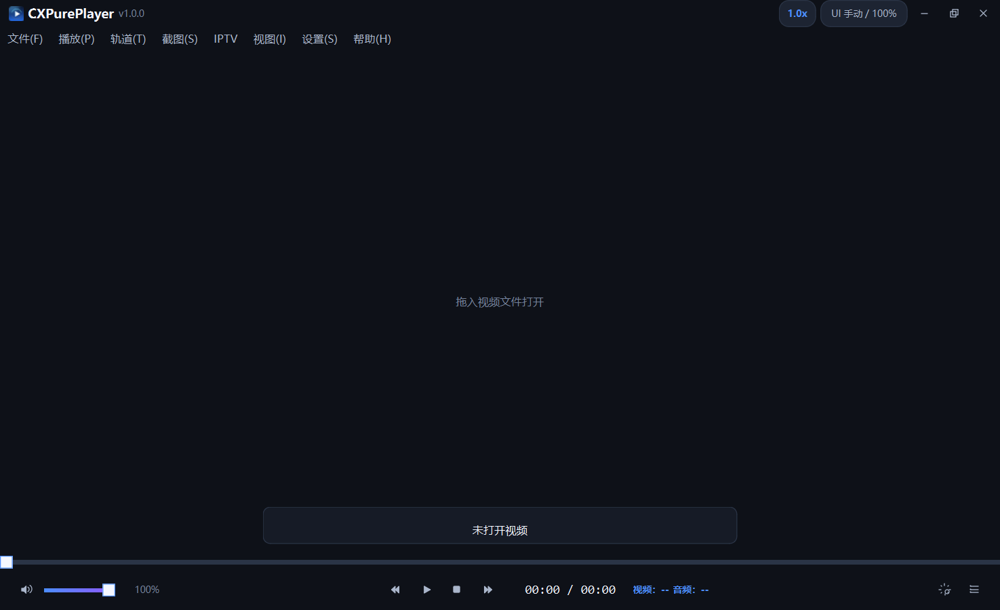

# CXPurePlayer v1.0.0

本地视频播放器 + IPTV 播放器。基于 PySide6 与 libmpv，科技 / 现代 / 互联网风格界面，单文件 EXE 分发，开箱即用。

> **v1.0.0 基线功能已全部交付。** 本 README 仅描述当前已实现能力；循环模式、字幕样式、截图格式输出等 P1 增强，以及画中画、EPG、在线拉取列表、macOS / ARM64 等远期项，均不属于 v1.0.0 范围。

## 功能特性

### 已实现（v1.0.0）

- 本地播放：播放 / 暂停 / 停止 / 进度定位 / 全屏 / 静音与音量调节，支持 8 档倍速；倍速在标题栏右上角以实际档位徽标展示（如「0.75x」「1.0x」「1.25x」），点击即选即生效。
- 文件打开：菜单 `Ctrl+O`、拖放文件到视频区、命令行参数，以及右键「打开方式」或双击关联文件均可打开本地视频。
- 记忆播放位置：开启后在 `settings.ini` 中按文件分别保存进度，重新打开自动续播，播完自动清除，超过 30 天未再播放的记录自动清理。
- 轨道与字幕：内置音轨 / 字幕切换并带选中标识，支持添加外部音轨与外挂字幕（含编码选择）。
- 属性信息：分节式文本（General / Video / Audio / 字幕 / 章节），字段直接取自 libmpv，可一键复制；`Tab` 可唤出播放 / 视频 / 音频合并单页信息 OSD，支持滚动查看。
- 截图：单张截图、源图 N×M 缩略图拼接、连续截图（默认 5 张）；统一输出源分辨率 PNG，文件名带视频名前缀与截图时间戳。
- IPTV：本地 m3u / m3u8 导入导出、频道增删改、频道树管理，支持临时播放 IPTV 频道 URL；IPTV 页只保留频道管理，导入 / 导出为图标按钮（悬浮显示文字），编辑 / 删除按钮中英文等宽。
- 录制：菜单 `IPTV → 新建录制任务` / `IPTV → 显示录制任务` 可新建或查看任务（独立任务窗口，不在右侧抽屉内）；新建时电视台从已导入频道下拉选择，支持定时并发录制多个频道、同源 / TS / MP4 / MKV 封装选择（只换封装、不重编码）、停止 / 取消、断流重试与重启后任务恢复。
- 主题与语言：7 套主题、简体中文 / 繁体中文 / English，切换后主窗口及各弹窗、抽屉即时同步；播放列表抽屉与列表宽度不随语言文案长短变化。
- 分辨率自适应：覆盖 720p ~ 6K 与系统 DPI 100%–200%，支持自动档与手动覆盖（80%–200%）；缩放只影响界面，不改变视频、截图和录制输出。
- 无边框窗口：标题栏、视频区和控制栏空白处可拖动移动；四边四角可拖动缩放，打开视频后自动锁定画面比例并保持视频区无黑边；打开视频按物理像素 1:1 适配窗口，2560×1440 / 125% 缩放下播放 1920×1080 视频不会误最大化；底部控制栏高度为原基准的 70%。
- 全屏交互：进入全屏后标题栏与底部控制栏自动隐藏，鼠标移到上 / 下边缘时对应栏滑入，离开后滑出，视频画面尺寸不变；从最大化进入全屏后，`Enter`、`Esc` 或右上角按钮均可恢复原窗口状态；全屏 `Space` 仍可播放 / 暂停，`←` / `→` 仍可快退 / 快进；全屏中打开播放列表不遮挡底部列表按钮、可再次点击收缩。
- 日志：常规日志 `log/yyyy-MM-dd.log` 与录制日志 `log/yyyy-MM-dd-record.log` 分离，各自自动清理 30 天前文件。

### 待实现（P1 增强）

- 循环模式、音画同步、字幕样式。
- 最近文件与播放列表持久化、窗口置顶与自定义画面比例设置。
- 立即录制、录制二次确认、频道排序与禁用切换。
- 外挂轨道移除与字幕编码 UI。
- 截图格式输出与 JPG 质量（当前统一输出 PNG，设置中的格式选项为占位项，暂不生效）。
- OSD 自动隐藏、混合 DPI 多屏自动跟随、关于对话框版本详情。

### 待实现（远期目标）

- 画中画、睡眠定时、自动下一集。
- 通用 URL 流、EPG / 节目回看、在线拉取 m3u8 列表。
- macOS / ARM64 适配。

## 下载与安装

当前版本：**v1.0.0**。v1.0.0 仅提供 Windows x64 单文件 EXE。

| 平台 | 文件 | 说明 |
| --- | --- | --- |
| Windows 10 / 11 x64 | `CXPurePlayer-v1.0.0-win-x64.exe` | 单文件 EXE，无需安装，内置 LGPL 版 libmpv 与 Qt 运行时 |

- 直接双击运行即可；配置与数据写在 EXE 同目录：`settings.ini`、`channels.json`、`recordings.json`、`record/`。
- 发布包不需要额外安装 FFmpeg / ffprobe，也不需要系统编解码器。
- 如需通过文件关联打开视频，可在资源管理器中右键视频文件，选择「打开方式」并指定本 EXE。

## 快速开始

1. 运行 `CXPurePlayer-v1.0.0-win-x64.exe`。
2. 按 `Ctrl+O`、拖入视频文件，或在资源管理器中通过文件关联打开。
3. 使用空格播放 / 暂停，方向键定位与调音量，右上角倍速徽标切换播放速度。
4. 按 `Tab` 查看播放信息 OSD，按 `F6` / `Ctrl+L` 打开播放列表。
5. 打开右侧 IPTV 面板导入本地 m3u / m3u8 文件，或按 `Ctrl+U` 临时播放一个 IPTV 频道 URL。
6. 在菜单 `IPTV → 新建录制任务` 中新建定时任务，可同时录制多个频道，并随时通过 `IPTV → 显示录制任务` 停止或取消。

## 界面预览



## 功能说明

### 播放、倍速与记忆位置

- 支持常见本地音视频格式与外挂音轨 / 字幕，播放结束默认停止。
- 倍速按实际选择值显示，整数档位显示为 `1.0x` / `2.0x`，非整数档位显示为 `0.75x` / `1.25x`，不会四舍五入。
- 开启「记住播放位置」后，每个视频独立记录进度；仅本地文件参与，直播频道不记录。

### 属性信息与 Tab OSD

- 属性信息为单页只读文本，覆盖文件容器、视频流、音频流、字幕轨与章节；扫描方式（逐行 / 隔行上、下场优先）在本地文件与 IPTV 直播中均可显示；封面图片按附件展示，不误判为视频流。
- Tab OSD 固定在视频区左上角，为不透明圆角浮层，无边框；内容按 16 行布局、20 行高度计算，超出可用高度时可滚动查看。

### 截图三种模式

- 单张截图：输出当前帧为源分辨率 PNG。
- 缩略图：按自定义 N×M 拼接为一张 PNG，默认 2×5。
- 连续截图：按张数 / 间隔连续抓帧，默认 5 张；任务在后台线程执行，可取消。
- 三种截图均默认保存到 EXE 所在目录，每次操作仍可选择位置，不跨操作记忆。

### IPTV 与录制

- 本地 m3u / m3u8 文件可导入、合并去重并导出；支持相对 URL 基于列表文件目录补全。
- 频道管理支持新增、编辑、删除；录制任务支持新建、编辑、停止（仅录制中）、取消、删除与打开输出文件 / 文件夹；任务列表显示创建时间（到秒），可逐行勾选或全选后批量删除（录制中的任务会跳过并提示）。
- 录制基于 libmpv `stream-record`，默认同源封装，可选 TS / MP4 / MKV；**不提供 FLV**，也**不重编码**。
- 程序退出时会对录制中任务执行正常停止并保存文件；流中断按设置间隔重试，磁盘空间不足时阻止提交任务。

### 主题、语言与缩放

- 主题、语言与 UI 缩放使用同一套全局同步机制，切换后立即刷新主窗口、菜单、抽屉、对话框与 Tab OSD，无需重启。
- 自动缩放按主屏逻辑分辨率分档，手动缩放范围为 80%–200%；设置中的「适配当前屏幕」可一键写入当前自动档。
- 所有界面尺寸由统一 `Metrics` 派生，QSS 随主题与缩放重建；视频渲染与输出文件分辨率不受界面缩放影响。

### 窗口与日志

- 主窗口为无边框窗口：标题栏可拖动，双击最大化；视频区与控制栏空白处可拖动移动；四边四角悬停显示方向光标并可拖动缩放。底部控制栏高度约为原基准的 70%（34px @ 100% 缩放），图标按钮同步收紧，三段式布局保持不变。
- 打开视频后按视频显示宽高比锁定缩放，视频区完整填充、无黑边；未播放视频时可自由调整窗口大小。
- 全屏时标题栏、菜单栏、进度条和控制栏从布局中移出成为浮层，视频区铺满屏幕；鼠标移到窗口上边缘时标题栏滑入，移到下边缘时进度条 + 控制栏滑入，离开后自动滑出。浮层只做位置动画，不改变视频区尺寸。
- 从最大化状态进入全屏后，`Enter`、`Esc` 或全屏标题栏右上角按钮都会退出全屏并恢复原最大化窗口；从普通窗口进入则恢复原几何。全屏状态下 `Space`、`←`、`→` 由独立快捷键处理，仍可播放 / 暂停与快进快退。
- 全屏时播放列表从主窗口停靠布局移出成为右侧浮层，底边止于进度条上方，不会遮挡底部控制栏的列表按钮，可再次点击收缩；退出全屏后自动恢复右侧停靠。
- 常规日志与录制日志分离，分别记录界面 / 播放问题与录制任务事件，便于定位。

## 快捷键

| 快捷键 | 功能 | 快捷键 | 功能 |
| --- | --- | --- | --- |
| `Ctrl+O` | 打开文件 | `Ctrl+Q` | 退出程序 |
| `Ctrl+U` | 打开 IPTV 频道 URL | `Ctrl+L` / `F6` | 播放列表 |
| `Ctrl+I` | 属性信息 | `Ctrl+,` | 设置 |
| `Tab` | 播放信息 OSD | `Space` | 播放 / 暂停（全屏可用） |
| `S` | 停止 | `Enter` / `F11` | 全屏 / 退出并恢复原窗口状态 |
| `Esc` | 退出全屏并恢复原窗口状态 / 关 OSD | `←` / `→` | 快退 / 快进（全屏可用） |
| `↑` / `↓` | 音量 + / - | `M` | 静音切换 |
| `Alt+S` | 单张截图 | `Alt+T` | 缩略图截图 |
| `Alt+C` | 连续截图 | `F7` | IPTV 面板 |

## v1.0.0 范围说明

v1.0.0 已交付需求文档第 10 章列出的基线范围：本地播放与文件关联、倍速徽标、轨道、属性、控制栏、播放列表、三种截图、主题语言、设置与双日志、Tab 播放信息 OSD、IPTV 导入 / 管理 / 播放 / 定时并发录制（任务入口为 `IPTV → 新建录制任务` / `IPTV → 显示录制任务`）、封装选择 / 停止保存 / 健壮性、分辨率自适应、记忆播放位置（含 30 天过期）与无边框窗口交互。

以下内容**不属于 v1.0.0 已交付范围**：

- P1 增强：循环模式、音画同步、字幕样式、最近文件与列表持久化、窗口置顶与自定义画面比例设置、立即录制、录制二次确认、频道排序与禁用切换、外挂轨道移除 / 字幕编码 UI、截图格式输出与 JPG 质量、OSD 自动隐藏、混合 DPI 多屏自动跟随、关于对话框版本详情。
- 设置中保留了截图格式等 P1 占位项，但当前截图执行器统一输出 PNG，格式选择暂不生效。
- 远期目标：画中画、睡眠定时、自动下一集、通用 URL 流、EPG / 节目回看、在线拉取 m3u8 列表、macOS / ARM64 适配。

## 从源码运行

需要 Python 3.10 或更高版本。

```bash
python -m pip install -r requirements.txt
```

将 LGPL 构建的 `libmpv-2.dll` 放入 `bin/`，然后运行：

```bash
python main.py
```

源码模式下配置与日志写入项目根目录：`settings.ini`、`channels.json`、`recordings.json`、`log/`、`record/`。

## 打包

Windows x64 单文件 EXE 使用 PyInstaller 构建：

```bash
python -m PyInstaller --clean --noconfirm --distpath dist --workpath build build_tools/windows/build_x64.spec
```

产物为 `dist/CXPurePlayer-v1.0.0-win-x64.exe`，实测约 **67 MB**（70,565,129 字节）。构建脚本在 `Analysis()` 后裁剪 PySide6 hook 全量收集但项目未使用的 25 项 Qt 二进制，仅保留运行所需的 QtCore / QtGui / QtWidgets 与 qwindows、qico、qjpeg、样式插件。如需应急恢复全量打包，可在构建前设置环境变量 `CXPUREPLAYER_KEEP_QT_ALL=1`。

## 项目结构

```text
CXPurePlayer/
├── main.py                       # 程序入口
├── app/
│   ├── core/                     # 播放内核、配置、i18n、主题、缩放、日志、截图、M3U、录制
│   ├── ui/                       # 主窗口、播放列表、IPTV、OSD、属性、设置与各对话框
│   └── resources/                # 图标资源
├── build_tools/windows/          # PyInstaller spec 与版本信息
├── docs/                         # 界面预览与需求规格文档
├── tests/                        # 冒烟测试与专项回归脚本
├── THIRD_PARTY_NOTICES.md        # 第三方许可说明
└── README.md
```

## 许可与第三方组件

依赖组合采用 LGPL：LGPL 构建 libmpv + LGPL FFmpeg 组件 + PySide6 LGPLv3 + PyInstaller 打包例外，自有代码可闭源。详见 `THIRD_PARTY_NOTICES.md` 与 `CXPurePlayer-需求规格与设计方案.md` 第 6.6 节。

主要第三方组件：

- [libmpv](https://mpv.io/) — 本地播放、轨道、媒体信息与录制内核
- [PySide6 / Qt](https://doc.qt.io/qtforpython/) — 图形界面
- [PyInstaller](https://pyinstaller.org/) — 单文件打包

录制第三方 IPTV 流请遵守当地法律与频道版权。
